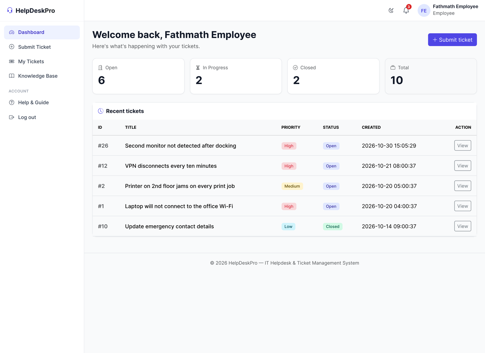
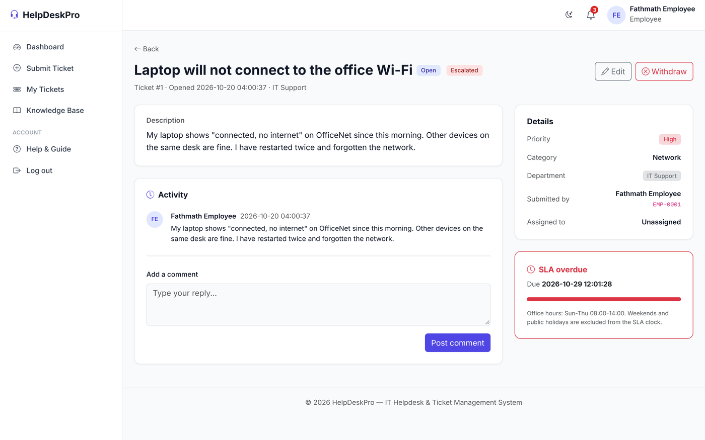
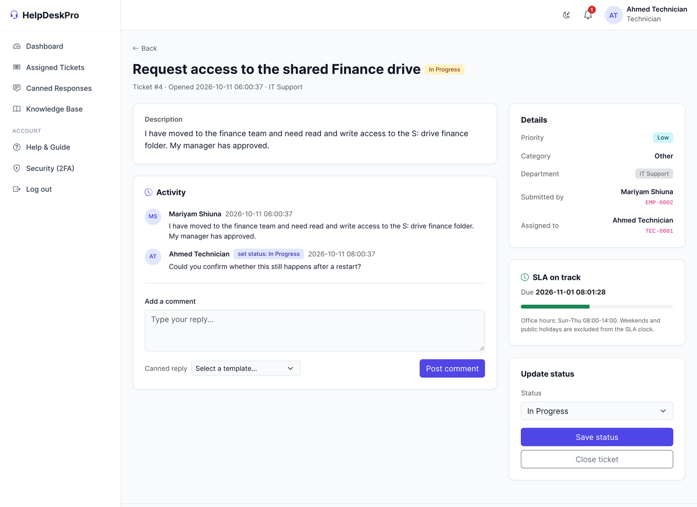
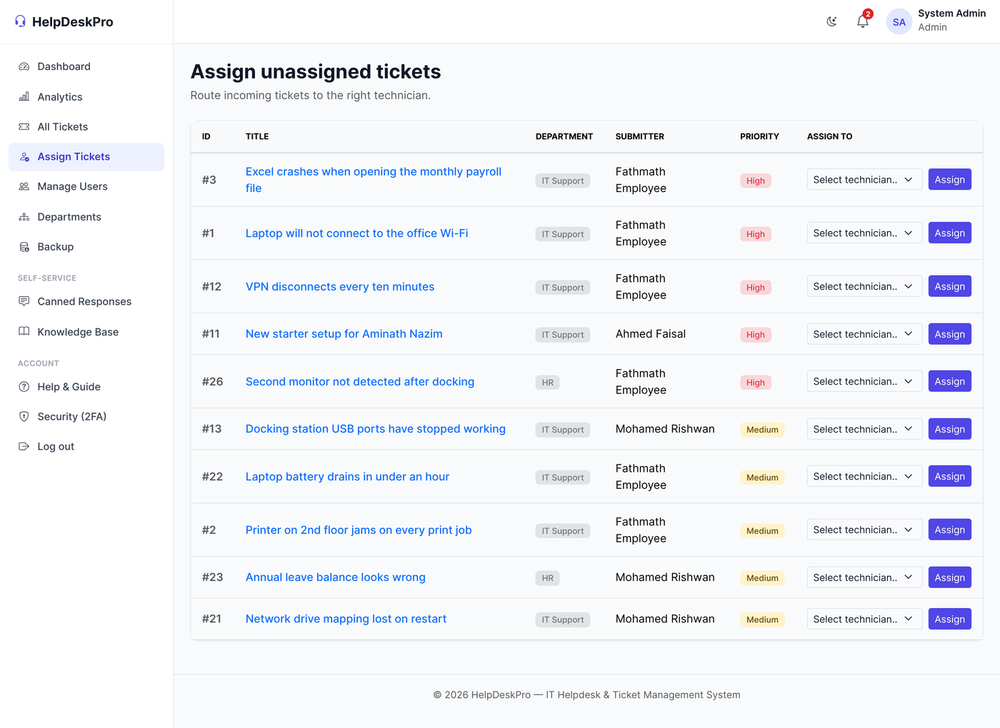
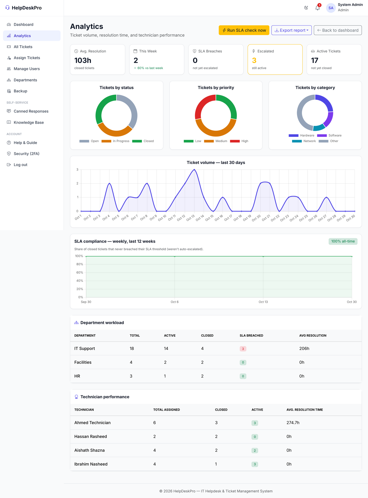
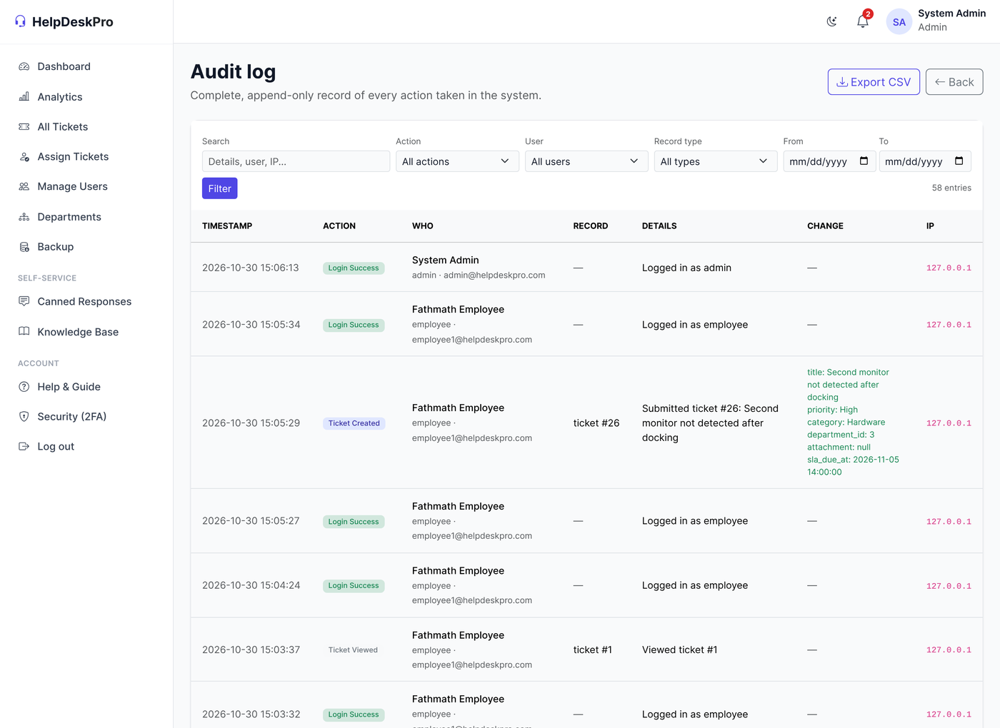
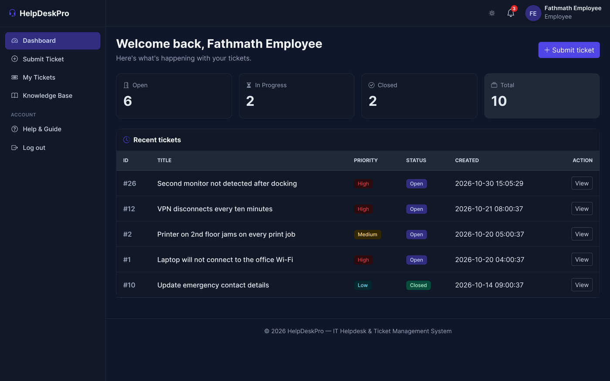
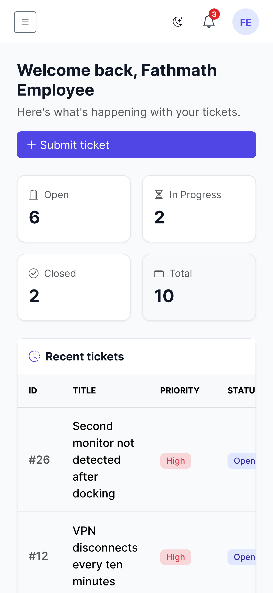

# HelpDeskPro

A web-based IT helpdesk and ticket management system built in PHP 8 and MySQL.

Employees raise support tickets, administrators route them to the right department, and technicians resolve them. Service level deadlines are measured in working hours rather than calendar hours, and every action is written to an audit trail.

**Live demo:** [helpdeskpro.ifree.page](https://helpdeskpro.ifree.page)

| | |
|---|---|
| **Student** | Ahmed Minshaavee Mohamed Shareef |
| **Student ID** | CYX29401 |
| **Module** | IT3004 |
| **Batch** | BIT-SA-A9 |
| **Lecturer** | Mr. Akbar Ali |
| **Institution** | Cyryx College |

---

## Screenshots

| Employee dashboard | Ticket detail |
|---|---|
|  |  |

| Technician working a ticket | Administrator assigning work |
|---|---|
|  |  |

**Analytics**



**Audit log** — every change records who, what, when, from which IP, and the values before and after.



| Dark theme | Mobile |
|---|---|
|  |  |

---

## Running it locally

**You need:** XAMPP, WAMP or MAMP with PHP 8.0 or later and MySQL 5.7 or later. Nothing else. There is no Composer step and no build step, because the production host does not allow either.

**1. Put the code in your web root**

```bash
git clone https://github.com/<your-username>/helpdeskpro.git
```

Move the folder into `htdocs` (XAMPP) or `www` (WAMP), then start Apache and MySQL from the control panel.

**2. Create the database**

Open <http://localhost/phpmyadmin>, go to the **Import** tab and import `database.sql`. It creates the `helpdeskpro` database, all 11 tables, and three starter accounts.

**3. Load the demo data (recommended)**

Import `demo_data.sql` the same way. This adds 11 more staff accounts, 25 realistic tickets across three departments and every status, comment threads, audit records, notifications and 20 canned reply templates, so there is something to look at straight away.

Skip this file if you would rather start from an empty system.

**4. Open it**

<http://localhost/helpdeskpro/login.php>

The default database settings in `config/db.php` are `localhost` / `root` / no password, which is what XAMPP ships with. Change them there if your MySQL setup differs.

---

## Test accounts

Password for all accounts: `password123`

| Role | Sign in with email | Or with staff ID | What you can do |
|---|---|---|---|
| Administrator | `admin@helpdeskpro.com` | `ADM-0001` | Everything: assign tickets, manage users and departments, analytics, exports, backup, audit log |
| Technician | `tech1@helpdeskpro.com` | `TEC-0001` | Work the tickets assigned to you, post updates, change status, close |
| Employee | `employee1@helpdeskpro.com` | `EMP-0001` | Raise tickets, track them, search the knowledge base |

The sign-in field accepts either an email address or a staff ID.

---

## A five-minute tour

If you only have a few minutes, this path covers the parts worth seeing:

1. **Sign in as the employee.** Submit a ticket. Note that the confirmation gives an SLA deadline counted in working hours.
2. **Open the ticket.** The panel on the right states the deadline and that weekends and public holidays are excluded from the clock. While the ticket is unassigned, **Edit** and **Withdraw** are available.
3. **Sign in as the administrator** and open **Assign Tickets**. Pick a technician. The dropdown only offers technicians from that ticket's own department, and the server checks it again on submit.
4. **Sign in as the technician.** The ticket is now in your queue. Use the **Canned reply** dropdown under the comment box, then close the ticket.
5. **Back as the administrator**, open **Analytics** for the charts and the SLA compliance trend, then **Audit log** to see every one of those actions recorded with before and after values.

---

## What it does

**Ticket lifecycle** — Submit with category, priority, department and an attachment. Edit or withdraw while unassigned. Comment, reassign, change status, close and reopen.

**Business-hours SLA** — Deadlines are calculated by stepping through working hours only, configured in `config/business_hours.php` and defaulting to Maldives government hours: Sunday to Thursday, 08:00 to 14:00, with a public holiday list. A ticket raised on Thursday afternoon does not lose SLA time over the weekend. Breached tickets are flagged and their priority is raised one step.

**Department routing** — Tickets belong to a department. Technicians see only the tickets assigned to them; administrators route work from a single unassigned queue.

**Knowledge base** — Searchable articles with helpfulness voting, offered to the user while they are filling in the ticket form.

**Security** — bcrypt password hashing, CSRF tokens on every form, PDO prepared statements throughout, login rate limiting counted per account, optional TOTP two-factor authentication, session timeout, forced password change on first sign-in, and an optional password expiry policy.

**Audit trail** — Every state-changing action writes a record holding the actor, the action, the entity, the timestamp, the IP address and the field values before and after the change. The log cannot be edited or deleted from the interface.

**Reporting** — Role dashboards, Chart.js analytics, CSV and PDF export, SLA compliance trend, and an on-demand SQL backup download.

**Interface** — Bootstrap 5, responsive from 360 px upward, with a light and a dark theme.

---

## Automated tests

The project has a zero-dependency test suite of **112 tests** covering authentication, role-based access control, the ticket lifecycle, SLA arithmetic, staff ID allocation and audit logging.

```bash
php tests/run_tests.php
```

The suite builds and tears down its own disposable database. As a safeguard it refuses to run unless the database name contains `_test` and the host is not remote, so it cannot be pointed at live data by mistake.

See [`tests/README.md`](tests/README.md) for details.

---

## Project structure

```
├── admin/              Administrator pages: users, departments, assignment,
│                       analytics, exports, backup, audit log
├── technician/         Technician pages: dashboard, assigned tickets,
│                       canned responses, knowledge base management
├── employee/           Employee pages: dashboard, submit, my tickets, edit
├── includes/           Shared logic loaded by every page
│   ├── functions.php       entry point; loads everything below
│   ├── security.php        auth, rate limiting, sessions, audit logging
│   ├── business_hours.php  the working-hours SLA engine
│   ├── staff_id.php        forward-only staff ID allocation
│   ├── escalation.php      SLA breach sweep
│   ├── csrf.php            token generation and verification
│   ├── notifications.php   in-app notifications
│   ├── backup.php          SQL backup generation
│   ├── header.php          sidebar, top bar, theming
│   └── footer.php
├── config/             Database, mail, business hours, security policy, cron
├── lib/                Vendored libraries: PHPMailer 6.9.1, FPDF 1.86
├── assets/             CSS and images
├── cron/               SLA escalation endpoint for hosts that provide cron
├── tests/              Automated test suite
├── docs/               Screenshots and development notes
├── database.sql        Schema and starter accounts
└── demo_data.sql       Optional sample data
```

---

## Technology

| Layer | Used |
|---|---|
| Server | PHP 8.3, Apache 2.4 |
| Database | MySQL 5.7 / MariaDB 10.6, accessed through PDO with prepared statements |
| Interface | Bootstrap 5.3.3, Bootstrap Icons 1.11.3, Chart.js 4.4.4 |
| Email | PHPMailer 6.9.1 (vendored) |
| PDF | FPDF 1.86 (vendored) |

PHPMailer and FPDF are committed to `lib/` rather than installed through Composer, because the production host does not allow Composer to run.

---

## Notes

**Database credentials.** `config/db.php` is committed with XAMPP defaults so the project runs immediately after a clone. Production credentials live on the server only and are not in this repository.

**Email.** Password reset email needs SMTP details in `config/mail.php`. The system works without it; an administrator can set a temporary password instead.

**Scheduled escalation.** The SLA breach sweep runs when an administrator loads a page, because the free host provides no cron daemon. On a host with cron, point it at `cron/escalate_tickets.php` and set a secret in `config/cron.php`.

Further documentation, including the design decisions behind each feature, is in [`docs/DEVELOPMENT_NOTES.md`](docs/DEVELOPMENT_NOTES.md).

---

## Licence

Submitted as coursework for module IT3004 at Cyryx College.
